# QtPlot

**English** | [繁體中文](README.md)

An **interactive plotting library built from scratch on Qt Widgets + QPainter**, plus a Cookbook browser with hundreds of examples.
Its feature set is modelled on [ScottPlot](https://scottplot.net/).

The plotting core **does not use Qt Charts**: coordinate mapping, tick generation, layout, legends and mouse interaction are all implemented here.
That is deliberate. Qt Charts locks down its axes and interaction, so it cannot do what ScottPlot is known for:
million-point `Signal` decimation, custom tick generators, multiple bound axes, and so on.

## Gallery

Every image below was drawn by `QtPlotDemo --export --lang en` — 12 of the 451 recipes:

<table>
<tr>
<td align="center">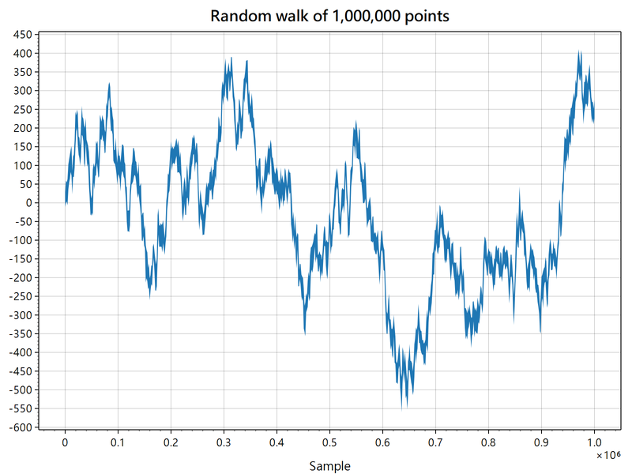<br><sub>Million-point Signal (per-pixel decimation)</sub></td>
<td align="center">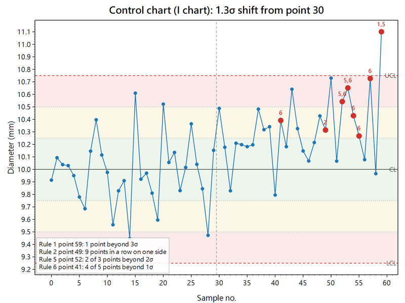<br><sub>Control chart with Nelson rules</sub></td>
<td align="center">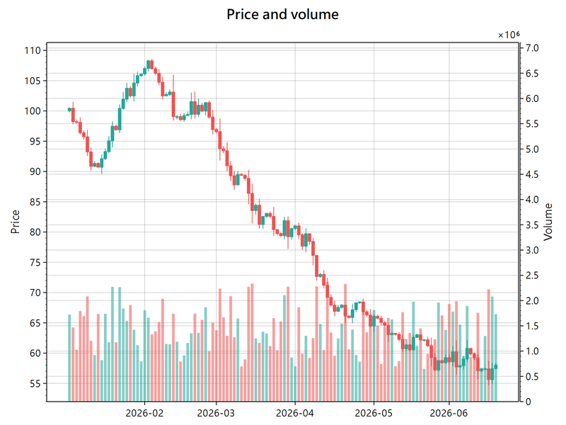<br><sub>Candlesticks and volume (two Y axes)</sub></td>
</tr>
<tr>
<td align="center">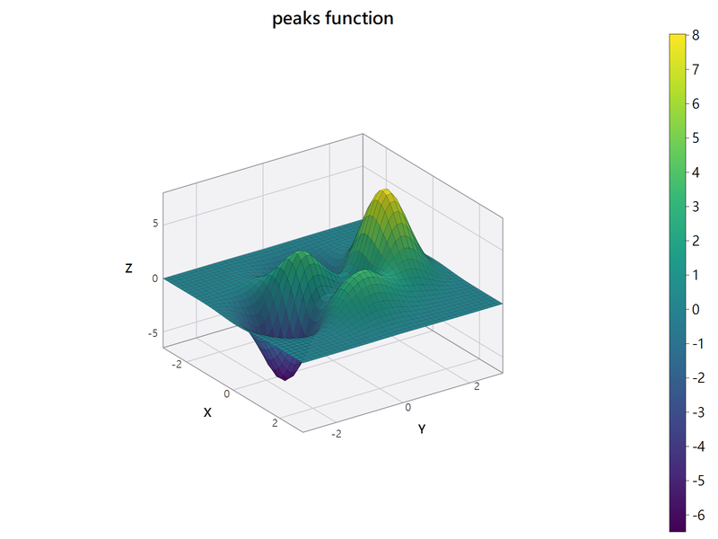<br><sub>3-D surface</sub></td>
<td align="center">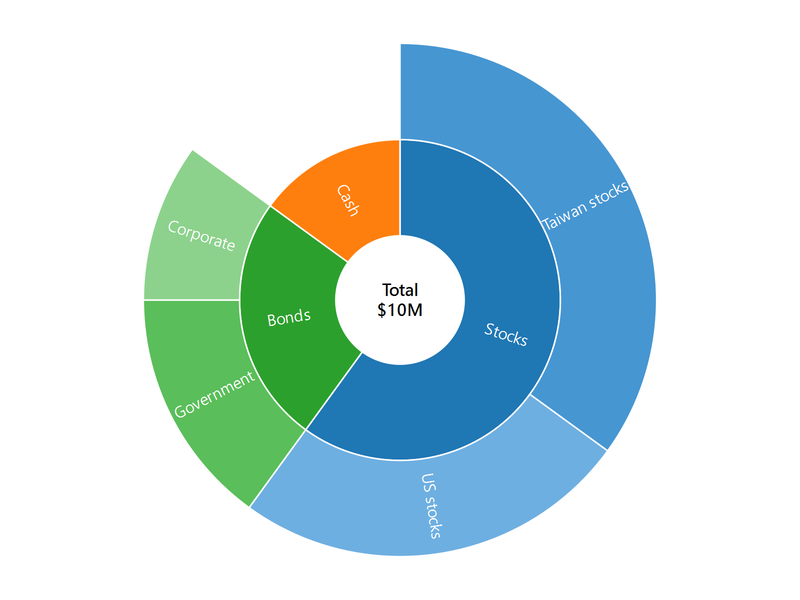<br><sub>Sunburst</sub></td>
<td align="center">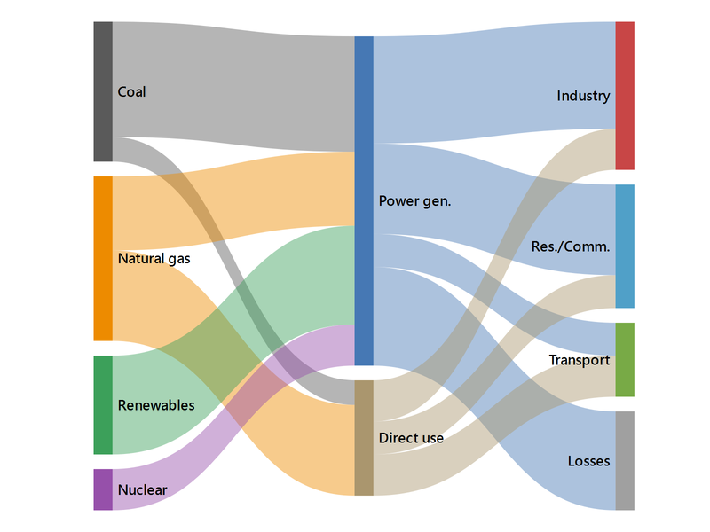<br><sub>Sankey diagram</sub></td>
</tr>
<tr>
<td align="center">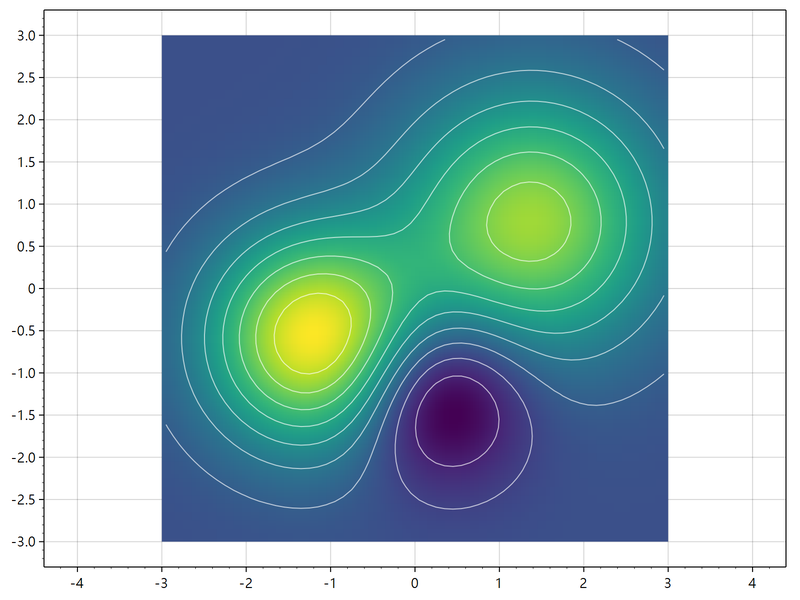<br><sub>Contours over a heatmap</sub></td>
<td align="center">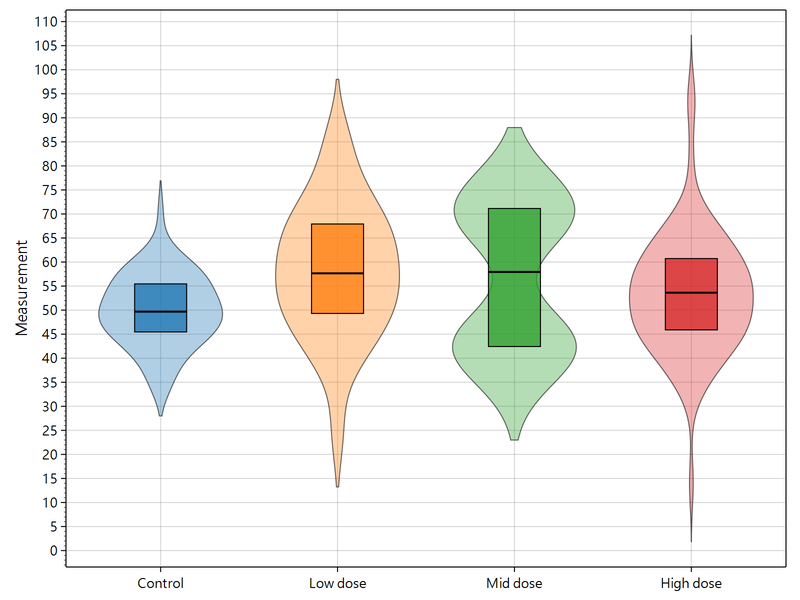<br><sub>Violin plot</sub></td>
<td align="center">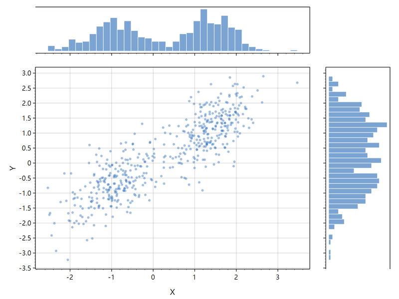<br><sub>Joint plot (subplots)</sub></td>
</tr>
<tr>
<td align="center">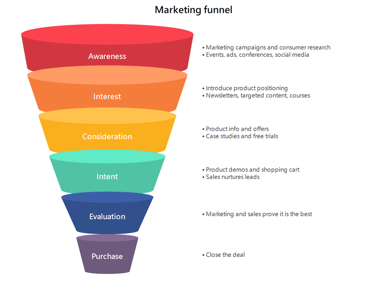<br><sub>Cone funnel infographic</sub></td>
<td align="center">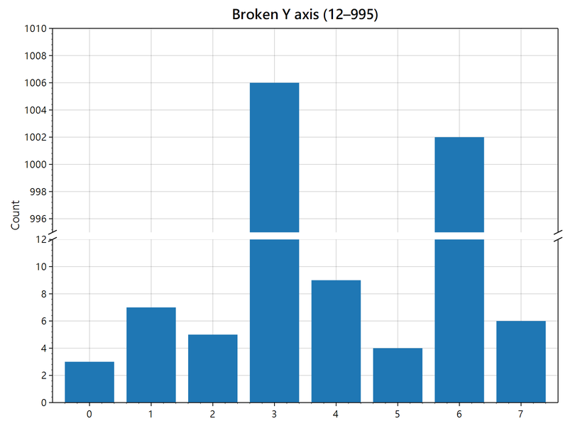<br><sub>Broken Y axis</sub></td>
<td align="center">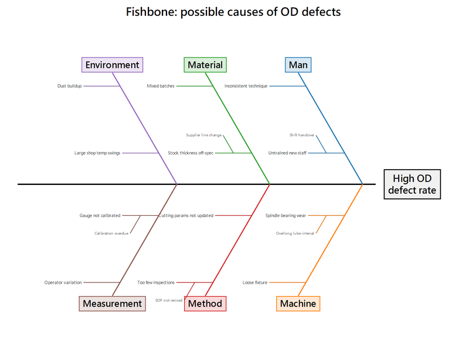<br><sub>Fishbone (Ishikawa) diagram</sub></td>
</tr>
</table>

## Status

| Area | Status |
|---|---|
| Core engine (coordinates, ticks, layout, legend, rendering) | Working |
| Mouse interaction (pan / zoom / box zoom / auto scale) | Working |
| Plot types | 84 (see table below) |
| Cookbook | 451 recipes in 15 chapters (10 animated, 10 that need mouse interaction, 5 multi-plot layouts) |
| Self-checks | `qtplot_selftest` (numeric checks), `--soak` plot-switching test, widget / C API / C# tests, all run by `ctest` |
| Interaction | Pan / zoom / box zoom, hit testing (2-D or X-only), hover tooltips, crosshair snapping to data, box-selecting points, dragging plottables, shared axes between plots, **click legend to toggle series**, **view undo / redo (Ctrl+Z / Ctrl+Y)**, **touch and touchpad gestures**, **animated view transitions** |
| Output | PNG (any scale), SVG, **PDF**, clipboard, **printing with preview** |
| Languages | Traditional Chinese (source), English, Simplified Chinese, Japanese, Korean, French, German, Italian, Spanish; switchable at runtime, existing plots update |
| Build | MSVC 2022 x64 + Qt 6.11.1, warning-free at `/W4` |

### Plot types

| Group | Plottables |
|---|---|
| Scatter and lines | `Scatter` (with step lines and fills), `Markers`, `BubbleChart`, `Signal`, `SignalXY`, `FunctionPlot`, `FillY` |
| Bars and statistics | `BarPlot` (vertical / horizontal / stacked / grouped / diverging / error bars / value labels), `Bars3D` (extruded 3-D bars), `ErrorBar`, `Histogram` |
| Business charts | `Funnel` (funnel / pyramid, can be drawn as a cone infographic with notes), `Waterfall`, `Bullet`, `Gantt`, `Venn`, `Mosaic`, `Dumbbell`, `Fishbone` (Ishikawa), `Pareto`, `Waffle`, `Slope` (slope / rank change) |
| Hierarchy and multivariate | `Treemap`, `ParallelCoordinates`, `Hexbin`, `Dumbbell` |
| Flow and relations | `Sankey`, `Chord`, `NetworkGraph` (network / arc diagram), streamgraph (`addStream`), `Horizon` |
| 3-D charts | `Chart3D` (freely rotatable box: `Scatter3D`, `Line3D`, `SurfaceSeries3D`, `Waterfall3D` (with thickness: 3-D ribbon and area charts), `Columns3D`; perspective projection; `enableMouseRotation()` rotates by dragging) |
| Isometric (2.5-D) | `IsoBars`, `IsoStack` (pyramid / cylinder / cone), `Surface3D` (surface / wireframe / grid) — for presentation layouts, not precise reading |
| Heatmaps | `Heatmap` (7 colormaps, transparent NaN, bilinear interpolation), `CalendarHeatmap` |
| Reference lines and spans | `AxisLine` (can cover a segment only, label can sit on the axis), `AxisSpan` (edges draggable to resize), `Crosshair`, `TrendLine` (infinite line through two draggable points) |
| Shapes and annotations | `LabeledLine` (text along a line, angle follows the on-screen slope), `ColorGrid` (per-cell colours for categorical regions), `Shape` (rectangle / ellipse / polygon), `Sector` (sector / ring / ellipse / text along the arc), `Arc`, `Text`, `Annotation`, `Arrow` |
| Polar | `PolarAxis`, `Pie` (donut / exploded slices / extruded 3-D / leader-line labels), `Sunburst` (tangential / curved / radial / horizontal labels), `Coxcomb` (rose / stacked / donut, labels can run along the radius), `Radar`, `RadialGauge`, `RadialBarChart` (optionally distance-correct), `CircularHeatmap` (can be a half circle with text in cells) |
| Statistics | `BoxPlot`, `Beeswarm`, `Dendrogram`, `Lollipop`, `Population` (can form violin plots), `Ridgeline` (joyplot) |
| Diagnostics and inference | `ControlChart` (SPC with all eight Nelson rules), `ForestPlot` (meta-analysis); plus functions for Q-Q, ROC/PR, Kaplan–Meier, FFT / spectrogram, Bland–Altman, meta-analysis funnel plot with Egger's test, Lorenz curve / Gini, normal and Weibull probability paper |
| Finance | `Candlestick` (candles / OHLC bars), `Volume` |
| Fields | `ContourLines` (marching squares), `VectorField` |
| Layout | `Multiplot` (m×n subplots, spanning, weights, shared axes, aligned data areas), `MultiplotWidget`, `InsetPlot` |
| Live data | `DataLogger` (Full / Jump / Slide view), `DataStreamer` (Wipe / Scroll ring buffer), `DataStreamerXY` (irregular sampling) |
| Annotations | `Tooltip` (speech bubble), `Callout` (leader line), `Bracket`, `ScaleBar`, `ImageRect` |
| Special coordinates | `TriangularAxis` (ternary), `SmithChartAxis`, `PhasorPlot`, `TIN` (Delaunay triangulation) |
| Decorations | `Colorbar`, `ImageMarker`, `FloatingAxis` (axis inside the data area), `LegendPanel` (additional legends) |

Statistics helpers can also be used on their own: `BoxStats::fromValues()` (five-number summary and Tukey outliers),
`linearFit()` (least squares + R²), `kernelDensity()` and `silvermanBandwidth()`.

Plot types and interaction match ScottPlot 5, and QtPlot additionally has a `Colorbar`, which ScottPlot does not.

Other details: legends can have titles, multiple columns, and can sit outside the data area (right or bottom); kernel density offers 5 kernels (`KernelType`); arrows have 6 head styles (`ArrowHead`) and can be double-ended; heatmaps support overall opacity, per-cell opacity (`alphaMap`) and centred cells (`cellCentered`); date axes can use fixed intervals (e.g. every Monday); bar labels can go outside, centred or at the bar base (`Bar::labelPlacement`), each with its own colour.

Third batch of additions (after comparing against all 541 ScottPlot Cookbook recipes):

- **Ticks**: `AutomaticTickGenerator::tickDensity` / `targetTickCount`; `LogTickGenerator::minorMultipliers`; `DateTimeTickGenerator::labelFormatter` (format can change with zoom level).
- **Axes**: `Axis::subLabel` (secondary title), `Axis::labelImage` (image as title).
- **Layout and style**: `Plot::fixedDataRect`, `titleCenteredOnFigure`, `figureBorder`, `hairline`, `moveToFront()` / `moveToBack()`; `LineStyle::handDrawn`; `FontStyle::lineHeight`; legend `overrideMarkerShape`.
- **Colour**: `Palette::fromColors()` / `reversed()` / `inverted()`; `Colormap::reversed()` / `stepped(n)`, lookups keep alpha.
- **Data**: `Scatter` `xScale` / `yScale` / `xOffset` / `yOffset`, `fillAboveColor` / `fillBelowColor`, `markersBelowLine`; `Signal::yScale`; offset and scale for `SignalXY`; `Histogram::fromRange()` / `fromBinWidth()` / `probabilities()`; `gridScattered()` and `addContourScattered()` (contours from scattered points); `resampleOhlc()` and `Candlestick::barDuration`; `DataLogger::setY()`.
- **Dragging**: `IPlottable::beginDrag()` lets a plottable drag only *part* of itself: line endpoints (`Arrow::draggableEndpoints`), span edges (`AxisSpan::resizable`), rectangle edges and corners (`Shape::resizable`), individual data points (`Scatter` / `Markers::draggablePoints`).
- **Polar and special coordinates**: `RadialGauge` supports negative values, `Mode::Cumulative`, `reverseOrder`, `sweepAngle`, value-label position and font; `PolarAxis::polygonRings` / `ringStyles`; `PieSlice::fill` (hatching); `Population::boxMode` and component offsets (raincloud plots); `TriangularAxis` background, per-edge styles, edge titles, tick direction; `VectorField::maxArrowLengthPx`; `Bar::fill` (hatching) and `BarPlot::labelsOnTop`.

## Building

Requires Visual Studio 2022 (MSVC x64) and Qt 6.11.1.
`CMakeLists.txt` looks for Qt in `D:/Qt/6.11.1/msvc2022_64` by default; pass `-DCMAKE_PREFIX_PATH=...` for another location.

```powershell
powershell -ExecutionPolicy Bypass -File build.ps1
```

After building, `ctest` runs automatically (about 10 seconds) and the script stops if anything fails:

| Test | What it checks |
|---|---|
| `selftest` | Numeric checks: ticks, coordinate mapping, statistics, axis breaks, decimation index, … |
| `soak` | Switches through every recipe in one `PlotWidget` and checks nothing is left behind |
| `demo_languages` | Cycles the demo through all nine languages: menus, recipe list and plot text must all change |
| `capi` | The C interface, compiled as plain C |
| `csharp` | C# → `qtplot_c.dll` → Qt end to end (skipped if no .NET SDK is installed) |
| `widget` | Translation, printing, animation, gestures, layer cache, auto refresh |

Add `-NoTest` to skip the tests when in a hurry.

Or by hand, from the project root:

```powershell
& "C:\Program Files\Microsoft Visual Studio\2022\Community\VC\Auxiliary\Build\vcvars64.bat"
cmake -S . -B build -G Ninja -DCMAKE_BUILD_TYPE=Release
cmake --build build
ctest --test-dir build --output-on-failure
```

## Running

The Qt runtime files (DLLs, platform plugin, image formats, styles) are copied next to the executable by `windeployqt` during the build,
so **no PATH changes are needed and the whole `build\bin\` folder can be copied to another machine**
(which still needs the MSVC 2022 VC++ redistributable). Use `-DQTPLOT_DEPLOY=OFF` to turn this off.

```powershell
QtPlotDemo                        # open the Cookbook browser
QtPlotDemo --recipe "散點圖"       # open and jump to a recipe (original or translated name)
QtPlotDemo --export out\          # no window: save all 451 recipes as PNG
QtPlotDemo --soak                 # no window: switch through every recipe the way the GUI does
QtPlotDemo --lang en              # UI language (en zh_CN ja ko fr de it es zh_TW)
```

`--export` is headless and can be used for visual regression testing: re-run it after changing the engine and compare the PNGs.

`--soak` checks something else: **switching plots**. It uses a single `PlotWidget`, draws all 451 recipes one after another,
and checks before each switch that nothing from the previous plot remains. Exit code 0 means clean.

### Mouse and keyboard

| Action | Effect |
|---|---|
| Left-drag | Pan |
| Right-drag | Zoom (horizontal drag zooms X, vertical zooms Y) |
| Middle-drag / Alt + left-drag | Box zoom |
| Wheel | Zoom around the cursor |
| Double-click | Auto scale |
| Right-click | Context menu (auto scale, copy, save, print, grid, legend, language, benchmark) |
| Ctrl+P | Print preview |
| Ctrl+Z / Ctrl+Y | Undo / redo the view |
| Hold Shift / Ctrl while dragging | X only / Y only |
| Hover near a data point | Show its value (`showTooltipOnHover`) |
| Left-drag a draggable plottable | Move it (reference lines, spans and annotations with `draggable` set) |

Touch screens: one finger pans, two-finger pinch zooms (and pans if both fingers move), tap toggles the legend, double-tap auto-scales.
Touchpads: pinch to zoom (native gestures on macOS / Linux; Windows precision touchpads send Ctrl + scroll, which is recognised
by input device type so both axes zoom instead of "Y only"). Set `gesturesEnabled = false` to disable.

Auto scale, box zoom and undo / redo animate smoothly over `animationDurationMs` (250 ms by default).
Panning and wheel zoom are direct manipulation and are not animated. Pressing the mouse during an animation stops it where it is.
From code: `animateTo(limits)` / `autoScaleAnimated()`.

### Axis breaks

```cpp
plot.leftAxis()->addBreak(12, 995);   // show 0–12 and 995+ on the same axis
```

The removed range takes no space; each segment gets its own ticks; the gap is painted across the data area and `//` marks are drawn on
both frame lines (`breakGapPx`, `breakMarkLine`, `fillBreakGap` are adjustable). Data, ticks and mouse coordinates all use the same mapping,
and auto-scale margins are computed from the visible length.

### Printing and languages

`PlotWidget::print(QPrinter&)` produces vector output, laid out at on-screen size and then scaled to the page, so text does not become tiny.
`printPreviewDialog()` / `printDialog()` are ready-made dialogs.

**Languages**: `qtplot::setLanguage("de")` switches language (empty string = follow the system). Users can also switch from the
"Language" submenu of the right-click menu (`languageMenuEnabled = false` removes it). Translations are compiled into the library,
so no `.qm` files need to be shipped. When the language changes:

- Plots already on screen update on the next repaint: text that `add*()` filled in automatically (Q-Q axis titles, the Pareto
  "cumulative %" axis, the fishbone 6M categories) is remembered by `Plot` and re-translated, and **text the user changed is never overwritten**.
  `PlotWidget` / `MultiplotWidget` repaint automatically on `LanguageChange`.
- Month and weekday names and number formats in the calendar heatmap follow `qtplot::displayLocale()`; the application-wide
  `QLocale::setDefault()` is not touched.
- C / C#: `qp_set_language("ja")`, `Plot.SetLanguage("ja")`.

The demo's menu bar also has a "Language" menu. Choosing a language switches the menus, the recipe list on the left (chapters, categories, names)
and the text drawn on the plots (titles, axis labels, legends, annotations); the choice is remembered. Only the recipe description above the plot stays in Chinese.

Chinese strings in the recipes are written as `RT("…")`; their translations live in `demo/i18n/recipes_<lang>.ts`.
After changing recipe text, run `python tools/recipe_i18n.py update`: new strings are added to every language's `.ts` (marked unfinished),
existing translations are kept, and the gaps can be filled in with Qt Linguist.
To add a language to the library: add `qtplot_<code>.ts` to `TS_FILES` in `src/qtplot/CMakeLists.txt`,
run `cmake --build build --target update_translations`, translate it in Qt Linguist and rebuild.

### Hit testing, selection and shared axes

`Plot::hitTest()` finds the data point nearest to a coordinate, `Plot::pointsInRect()` selects a whole region,
and `PlotWidget` emits `pointHovered` / `pointClicked` / `pointsSelected` / `plottableDragged`.

Hit distance is measured in **pixels**. The two axes often differ by orders of magnitude, so measuring in data units would let the larger axis
dominate and pick a point other than the one under the cursor. There are two modes: `HitMode::NearestXY` compares 2-D distance (natural for scatter plots),
`HitMode::NearestX` compares X only (sweeping along a time series does not jump to a neighbouring point because of a shaky hand).

A `Crosshair` with `followCursor` + `snapToData` follows the cursor and snaps to the nearest data point — between two points the cursor
reads an interpolated value that was never measured; snapping gives the real data.
`PlotWidget::linkAxes(other, shareX, shareY)` links the axes of two plots so that panning or zooming one moves the other
(the Cookbook's "View ▸ Shared Axes Demo" opens a ready-made window).

## Using it in your own program

```cpp
#include "qtplot/PlotWidget.h"

auto* w = new qtplot::PlotWidget(this);
w->plot().addScatter({1, 2, 3}, {1, 4, 9});
w->plot().title.text = "Measurements";
w->plot().autoScale();
```

With CMake:

```cmake
add_subdirectory(path/to/QtPlot/src/qtplot)
target_link_libraries(your_target PRIVATE qtplot)
```

`Plot` itself is not a QWidget and can draw onto any `QPainter`. The screen, PNG and SVG all use the same rendering path,
so saved images always match what is on screen.

## Architecture

```
src/qtplot/
  Core.h/.cpp        coordinate types, styles (line / marker / fill / font), palettes and colormaps, marker drawing, axis breaks
  Axis.h/.cpp        tick generators (automatic / manual / log / date-time) and axes
  Plottable.h        the IPlottable interface and RenderPack
  Plottables.*       16 Cartesian plottables
  Polar.h/.cpp       5 polar plottables (pie, rose, radar, radial gauge, polar axis)
  Statistics.*       3 statistics plottables + quartiles / regression / kernel density
  Finance.*          candlesticks and volume, date axis that skips non-trading days, SMA / EMA / Bollinger bands
  Field.*            contour lines (marching squares) and vector fields
  Live.*             live data: DataLogger (accumulating) and DataStreamer (ring buffer), thread-safe
  Decimation.*       min/max index and envelope rendering for large data
  Annotations.*      callouts, brackets, scale bars, images
  Specialty.*        ternary, Smith chart, phasors, Delaunay triangulation and TIN
  Decorations.*      colorbar, image markers, floating axes
  Selection.cpp      box selection and dragging
  Smoothing.cpp      smooth curves, partial rendering, shape rotation
  Translation.*      language switching (translations in i18n/)
  Plot.h/.cpp        the plot model: axes, plottables, legend, layout, rendering, output
  PlotWidget.h/.cpp  QWidget shell: mouse, touch, animation, printing, layer cache
  DataGen.h/.cpp     example data generators (fixed seed, reproducible plots)
src/qtplot_c/        C interface DLL (qtplot_c.dll)
bindings/csharp/     C# wrapper (Plot, PlotControl) and demo
demo/
  Recipe.h/.cpp      recipe registration
  MainWindow.*       the Cookbook browser
  recipes/*.cpp      the recipes themselves (source compiled into qrc and shown in the browser)
  i18n/              demo UI and recipe translations
tests/               selftest, widget test, C API test, benchmark
tools/               recipe_i18n.py (recipe translations), check_fonts.py
```

### Pitfalls worth knowing

- **Pixel y points down, data y points up.** `PixelRect` has `top < bottom`, `CoordinateRect` has `bottom < top`.
  Always convert through `Transform`; never do the math inside a plottable.
- **Plottables must not cache pixel coordinates.** Zooming, changing axes or themes does not notify plottables; keep only data and style as state.
- **Set the view with `setAxisLimits()` or `Axis::setRange()`**, not by writing `axis->range = {...}`.
  Directly written values are overwritten by `autoScale()`; axes set through the setters are skipped by `autoScale()`
  (but can still be panned and zoomed, unlike `locked`). When the user explicitly clicks "Auto scale", `autoScale(fraction, force = true)`
  recomputes even those axes.
- **`Signal` computes X** instead of storing an array. When there are more points than pixels it draws each pixel column's min/max,
  which looks identical to drawing every point but is orders of magnitude faster.
- **Polar plots are still Cartesian underneath.** Every point goes through `fromPolar()` to (x, y) before `Transform`, so zooming, panning
  and output need no special handling; the price is that circles become ellipses when the two axes have different scales.
  `Plot::usePolarLayout()` (called automatically by shortcuts such as `addPie`) turns on `equalAxisScale` and hides the Cartesian ticks and grid.
- **Smooth curves overshoot the data.** Catmull–Rom overshoots at turns: data rising from 0 to 1 and levelling off produces a curve that
  goes past 1 and comes back, as if 1.05 had been measured. Do not draw measurements this way; use `Interpolation::SmoothMonotone`
  (Fritsch–Carlson monotone cubic), which never leaves the data range.
- **Shape rotation happens in data coordinates.** With different axis scales a rotated circle becomes a tilted ellipse —
  which is correct for a rotation in data space. Turn on `equalAxisScale` if it should look rotated on screen.
  For the same reason `QPainter::rotate` cannot be used: it rotates pixel space.
- **Several axes on one side must make room for each other.** `Axis::renderOffsetPx` is filled in during layout, so a second left axis
  moves out by the thickness of the first. The offset only affects *where* it is drawn, not the coordinate mapping, so the data does not move.
- **Do not generate ticks by dividing the range evenly.** That produces values like 0.0713 / 0.303 / 0.535; tidy numbers need the
  1/2/5 selection rule. The colorbar and the axes share the same `TickGenerator` for exactly this reason.
- **Output must be reproducible.** `QHash` iteration order differs between processes (Qt randomises the seed). Delaunay collected hole
  boundaries in a QHash: the *set* of triangles was the same but the *order* changed, anti-aliasing then produced PNGs differing by one
  colour level, and hash comparison reported false regressions. Normalise the order of any container iteration that affects output.
- **Things pinned to a corner must put their labels on the inside.** The painter is clipped to the data area, so a `ScaleBar` at the edge
  with an outside label gets its text cut off.
- **Do not compare geometry against exactly 0.** The Delaunay circumcircle test wobbles on floating-point edges for cocircular points
  (such as samples on a circle), the excavated hole stops being simply connected, and refilling it creates overlapping triangles.
  Thresholds must scale with the magnitude of the computation.
- **Plottables that adjust their own axes do it in `beforeLayout()`, not `render()`.** Layout and ticks are computed from axis ranges;
  changing an axis inside render is one frame late and the ticks do not match the data. Live data relies on this hook.
- **Lattice points and cells differ by half a cell.** Each `Heatmap` value is a *cell*; each `ContourLines` value is a *lattice point*.
  Using the same extent shifts the contours by half a cell; convert with `ContourLines::latticeExtentFor()`.
- **Document statistical definitions.** Quartiles use linear interpolation (R type 7, the `numpy.percentile` default) and whiskers use
  Tukey's 1.5 × IQR. A different definition moves the boxes, and someone comparing against R will have a hard time finding out why.
- **Jitter must share one random sequence per group.** Seeding one engine per point and taking its first output gives highly correlated
  values for adjacent seeds, so points drift to one side. Keep the seed fixed, or the points jump on every repaint.
- **Do not use `QPainter::drawPie` for arcs.** Its angles are not geometric angles on an ellipse, so arcs are skewed as soon as the axis
  scales differ. Always use `sectorPath()`, which approximates with segments and is correct under any scaling.

## Adding a plot type

Derive from `IPlottable` and implement two functions:

```cpp
class MyPlot : public qtplot::IPlottable {
public:
    qtplot::AxisLimits axisLimits() const override;  // the data range I occupy
    void render(qtplot::RenderPack& rp) override;    // draw myself
};
```

Inside `render()`, `transform(rp)` gives the coordinate mapping and the painter is already clipped to the data area.
Override `legendItems()` to appear in the legend.

## Adding a recipe

In `demo/recipes/*.cpp`:

```cpp
QTPLOT_RECIPE("章節", "分類", "名稱", "One or two sentences of description.") {
    plot.addScatter({1, 2, 3}, {1, 4, 9});
    plot.title.text = RT("標題");   // text drawn on the plot: wrap it in RT() so it gets translated
}
```

Animated recipes use `QTPLOT_RECIPE_LIVE(chapter, category, name, description, intervalMs)`, whose function takes an extra `frame`:
0 when building, then incremented every `intervalMs`. The Cookbook drives it with a QTimer, and PNG export runs 240 frames first —
**both use the same code**, so a recipe can never look animated while being drawn by a different piece of code.

Recipes that need window-level features (box selection, cursor snapping, dragging) use
`QTPLOT_RECIPE_WIDGET(chapter, category, name, description)` and receive a `PlotWidget&` instead of a `Plot&` —
these are behaviours of the *window*, not settings of the *plot*. PNG export creates a hidden PlotWidget and runs the same code.

The macros register themselves; no other file needs changing. The recipe source is read back from qrc and shown in the lower half of the browser,
so **the code on screen is the code that actually runs**. When adding a new `.cpp` file, also add it to
`demo/CMakeLists.txt` and `demo/recipes.qrc`, then run `python tools/recipe_i18n.py update` for the translations.

## Performance

`build\bin\qtplot_bench.exe` measures render time (1600×900, Release, fastest frame after the first):

| Scenario | Before | Now |
|---|---|---|
| Signal 1M / 10M / 50M points, full view | 54 / 78 / 114 ms | 11 / 17 / 10 ms |
| SignalXY 10M points | 79 ms | 16 ms |
| Scatter with 10k / 100k filled circle markers | 338 / 4583 ms | 8 / 35 ms |
| DataStreamer 100k points | 864 ms | 12 ms |
| Mouse hover (only the tooltip changes) | 46 ms | 0.3 ms |

How:

- **Min/max index** (`MinMaxIndex` in `Decimation.h`): above 16384 points, `Signal` / `SignalXY` build a hierarchy of per-block extremes,
  so the range of any segment is found in O(log n). It rebuilds automatically when the data changes — the index shares the QVector's
  memory with `ys`, so `ys[i] = …` detaches them and a pointer comparison detects it; users never have to notify anything.
- **Envelope rendering**: when there are more points than pixels, each pixel column takes min to max and adjacent columns are joined into one
  polygon filled in a single call. `DataStreamer` / `DataLogger` use the same path (they used to hand all 100k points to QPainter as one polyline).
- **Marker stamping**: with more than 400 markers on a raster target, one marker is drawn into a small image and stamped at each position.
  SVG / PDF / printers still get real vector shapes.
- **Layer cache**: `PlotWidget` keeps the plot as a bitmap; when only the tooltip or the selection rectangle changes it blits the cache.
  Call `refresh()` after changing data (a plain `QWidget::update()` also triggers a full repaint, but if it lands in the same frame as a mouse move
  it may show up one frame late). Set `layerCacheEnabled = false` to disable.
- **Feeding data from background threads**: `add*` and `clear` on `DataStreamer` / `DataStreamerXY` / `DataLogger` are locked and can be
  called from a frame grabber's or camera's thread. Background threads must not touch widgets, so use `PlotWidget::setAutoRefresh(ms)`
  (C#: `PlotControl.AutoRefreshInterval`): the GUI thread checks `dataVersion()` periodically and repaints only when there is new data.

The **first** render in a process takes about 0.4–0.8 s: that is Qt loading fonts for the first time (plus font fallback for characters such as
superscripts in ×10⁶), a one-off cost independent of the data. Every later frame runs at the speeds above.

There is no GPU (OpenGL / QRhi) acceleration: after decimation, the work per frame depends on the number of pixels, not the amount of data,
and the CPU already finishes in 10–20 ms. A GPU path would need custom shaders for anti-aliased lines and text — a high maintenance cost
that only pays off for millions of independent markers.

## Using it from C# (qtplot_c.dll)

C++ classes cannot be used across a DLL boundary from other languages, so there is a C layer: `src/qtplot_c/qtplot_c.h`.
qtplot itself stays a static library linked entirely into `qtplot_c.dll`, which exposes only the `qp_*` C functions.

```
build.ps1 ──► build\bin\qtplot_c.dll ──► bindings\csharp\QtPlot (QtPlot.Net.dll: Plot, PlotControl)
                                     └─► bindings\csharp\Demo (demo; --smoke is the ctest check)
```

```csharp
using var plot = new QtPlot.Plot();
var s = plot.AddScatter(xs, ys);
s.Legend = "Measured";
s.SetLine(Color.Crimson, 2).SetMarker(MarkerShape.OpenCircle, 5);
plot.Title = "Temperature";
plot.AutoScale();
plot.SavePng("out.png", 800, 600, scale: 2);
using Bitmap bmp = plot.RenderToBitmap(800, 600);   // draws straight into the Bitmap's memory, no extra copy
```

In WinForms, drop in a `PlotControl` (left-drag pans, wheel zooms, double-click auto-scales) and call `Invalidate()` after changing it.
In WPF, use `Plot.Render(byte[], w, h, stride)` into a `WriteableBitmap` (format `Pbgra32`).

- **x64 only**: set `PlatformTarget=x64` in the C# project.
- Referencing `QtPlot.csproj` copies `qtplot_c.dll`, the Qt DLLs and `platforms\qwindows.dll` to the output folder automatically;
  if the native DLLs are not in `build\bin`, pass `-p:QtPlotNativeDir=path`.
- The target machine needs the [VC++ 2015–2022 redistributable](https://learn.microsoft.com/cpp/windows/latest-supported-vc-redist).
- Errors are thrown as `QtPlotException`; after `Clear()` / `Reset()` old `PlotItem`s become invalid (they throw instead of crashing).
- 12 common plot types are wrapped so far (scatter, Signal, bars, histogram, heatmap, reference lines, text, live streaming, …).
  To add one: add a `qp_add_*` in `qtplot_c.h/.cpp`, one declaration in `Native.cs` and one method in `Plot.cs`.

```powershell
cd bindings\csharp
dotnet run --project Demo -c Release -p:Platform=x64
```

## Making sure an engine change did not break other plots

Three lines of defence. First the numeric checks:

```powershell
build\bin\qtplot_selftest.exe     # returns 0 if everything passes, otherwise the number of failures
```

`tests/selftest.cpp` verifies **purely numeric** behaviour: tick positions, coordinate mapping, quartiles, regression, technical indicators,
per-axis autoScale behaviour. Looking at plots only catches gross errors; a missing decimal place, the wrong denominator in a standard deviation,
or a date tick at the end of a month labelled as the start cannot be seen. When adding a plottable with verifiable numeric behaviour, add a check.

Then visual comparison: `--export` twice into different folders and compare file hashes:

```powershell
QtPlotDemo --export before
# ...change code, rebuild...
QtPlotDemo --export after
Get-ChildItem after\ -Filter *.png | Where-Object {
    (Get-FileHash $_.FullName).Hash -ne (Get-FileHash "before\$($_.Name)").Hash
} | Select-Object Name
```

If only the plots you expected to change are listed, the change did not leak into other plots.
The fixed-seed `DataGen` exists to make this work — random data is identical every run, so hashes are meaningful.

"Identical every run" is not enough, though; every recipe must also be independent. `DataGen`'s random engine is global,
so `Recipe::run()` calls `gen::resetSeed()` before each recipe. Without it, what a recipe draws depends on which recipes ran before it —
insert a new recipe in the middle of the list and every later recipe that does not call `setSeed()` itself changes, and hash comparison can no
longer tell real regressions apart. (This actually happened: adding 4 recipes changed 7 unrelated plots.)

Note that it is `gen::resetSeed()`, not `gen::setSeed(0)` — 0 means "seed from the clock", which would make every export different and
defeat visual regression testing entirely.

Finally the plot-switching test:

```powershell
build\bin\QtPlotDemo.exe --soak   # returns 0 when nothing is left behind
```

This one was added later, for a reason worth remembering: `--export` opens a fresh `PlotWidget` for every plot, so it is **always clean**
and never exercises "draw the next plot on the same Plot" — which is exactly what the GUI does. That gap once hid a bug: `Plot::clear()`
removed only plottables, axes added with `addAxis()` stayed, so after viewing a recipe with two axes on one side every later plot carried extra axes
and the ticks piled up. The exported PNGs were perfect; only the GUI showed it.

The fix moved responsibility for resetting back into `Plot`:

| Call | What it does | When to use it |
| --- | --- | --- |
| `Plot::clear()` | Removes plottables only; axes and layout stay | Redraw data but keep a multi-axis layout |
| `Plot::reset()` | Back to the freshly constructed state, extra axes removed | Switch to a **different** plot |
| `PlotWidget::resetPlot()` | `reset()` plus clearing the widget's cached pointers | Switching plots on a widget — always use this |

`PlotWidget` remembers the `IPlottable*` under hover, drag and selection. Calling `plot().reset()` directly leaves those pointers dangling,
and the next `paintEvent` steps on them. So on a widget, switch plots with `resetPlot()`.

## License

MIT — see [LICENSE](LICENSE).
