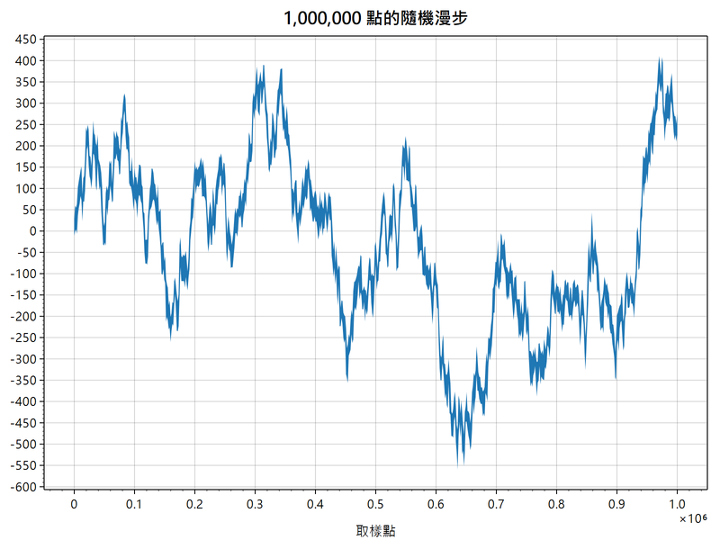
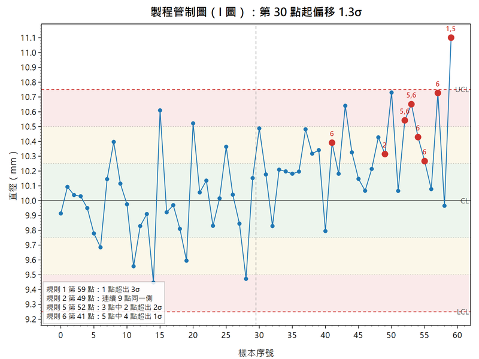
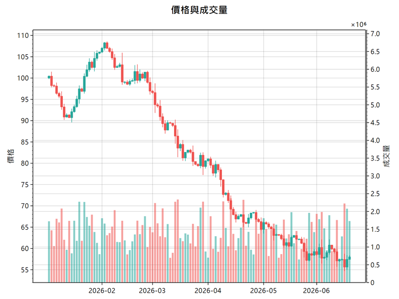
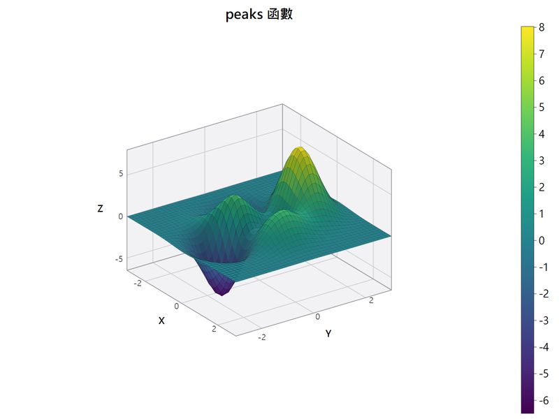
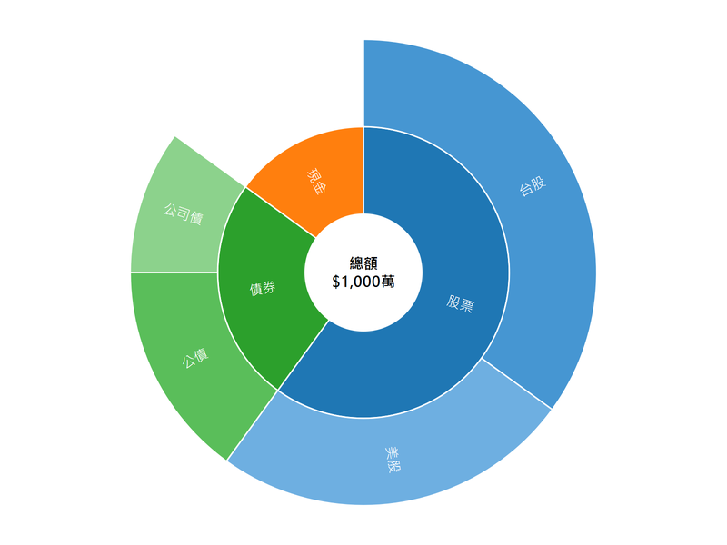
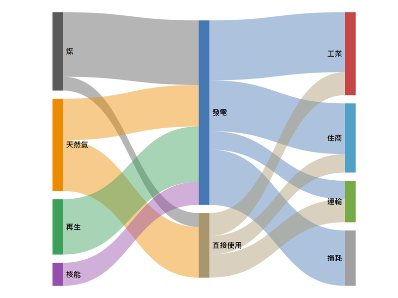
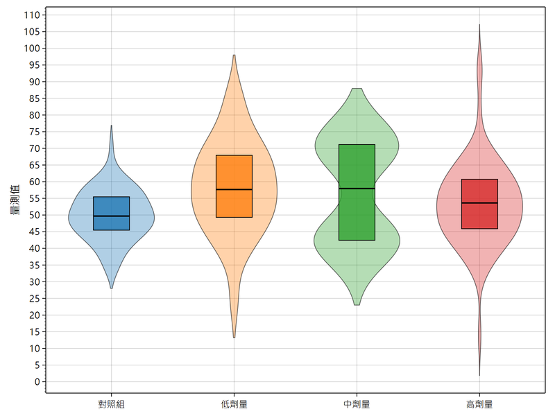
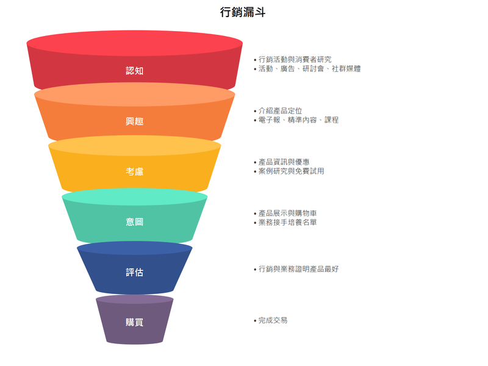
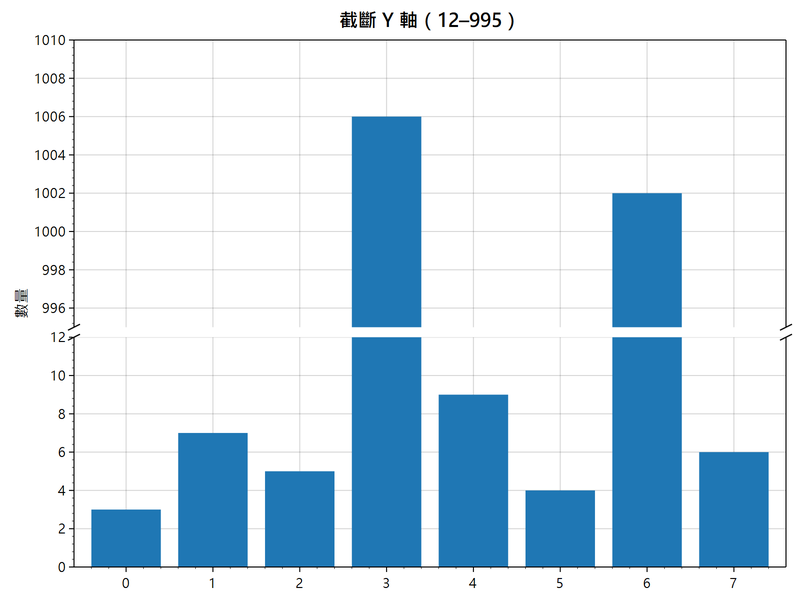
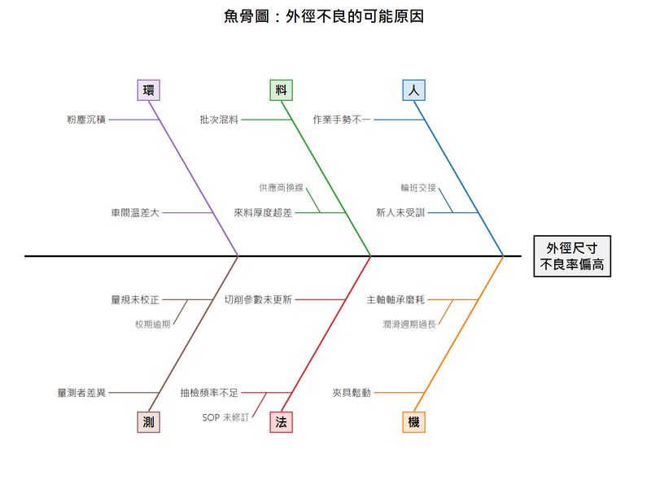

# QtPlot

[English](README.en.md) | **繁體中文**

用 **Qt Widgets + QPainter 自製的互動式繪圖函式庫**，加上一個 Cookbook 範例瀏覽器。
功能對標 [ScottPlot](https://scottplot.net/)。

繪圖核心**不使用 Qt Charts**：座標換算、刻度產生、版面計算、圖例與滑鼠互動全部自己實作。
這是刻意的選擇 —— Qt Charts 的座標軸與互動被框死，做不出百萬點的 Signal 抽樣、
自訂刻度產生器、多軸綁定這些 ScottPlot 的招牌行為。

## 範例圖

以下都是 `QtPlotDemo --export` 直接畫出來的，451 支範例裡的 12 支：

<table>
<tr>
<td align="center"><br><sub>百萬點訊號（每像素抽樣）</sub></td>
<td align="center"><br><sub>管制圖與 Nelson 規則</sub></td>
<td align="center"><br><sub>K 線與成交量（雙 Y 軸）</sub></td>
</tr>
<tr>
<td align="center"><br><sub>3D 曲面</sub></td>
<td align="center"><br><sub>旭日圖</sub></td>
<td align="center"><br><sub>桑基圖</sub></td>
</tr>
<tr>
<td align="center"><br><sub>等值線疊熱圖</sub></td>
<td align="center"><br><sub>小提琴圖</sub></td>
<td align="center"><br><sub>邊際分布（子圖）</sub></td>
</tr>
<tr>
<td align="center"><br><sub>圓錐漏斗資訊圖</sub></td>
<td align="center"><br><sub>截斷 Y 軸</sub></td>
<td align="center"><br><sub>魚骨圖（石川圖）</sub></td>
</tr>
</table>

## 現況

| 項目 | 狀態 |
|---|---|
| 核心引擎（座標、刻度、版面、圖例、渲染） | 可用 |
| 滑鼠互動（平移／縮放／框選／自動範圍） | 可用 |
| 圖元種類 | 84 種（見下表） |
| Cookbook 範例 | 451 支，15 個章節（10 支會動、10 支需要滑鼠互動、5 支是子圖） |
| 數值自我檢查 | `qtplot_selftest`，851 項；另有 `--soak` 換圖測試與 `tools/check_fonts.py` |
| 互動 | 平移／縮放／框選縮放、命中測試（二維／只比 X）、游標提示、吸附到資料點的十字線、框選資料點、拖曳圖元、兩張圖共用座標軸、**點圖例切換顯示**、**視野復原／重做（Ctrl+Z / Ctrl+Y）**、**觸控與觸控板手勢**、**視野切換動畫** |
| 輸出 | PNG（可指定倍率）、SVG、**PDF**、剪貼簿、**列印（含預覽）** |
| 語言 | 繁體中文（原文）、English、简体中文、日本語、한국어、Français、Deutsch、Italiano、Español；右鍵選單即時切換，畫好的圖跟著換 |
| 建置 | MSVC 2022 x64 + Qt 6.11.1，`/W4` 無警告 |

### 已實作的圖元

| 類別 | 圖元 |
|---|---|
| 散點與線 | `Scatter`（含階梯線與填色）、`Markers`、`BubbleChart`（氣泡）、`Signal`、`SignalXY`、`FunctionPlot`、`FillY` |
| 長條與統計 | `BarPlot`（直向／橫向／堆疊／群組／分歧／誤差線／數值標籤）、`Bars3D`（擠出式立體長條）、`ErrorBar`、`Histogram` |
| 商務圖表 | `Funnel`（漏斗／金字塔，可畫成圓錐資訊圖並附說明）、`Waterfall`（瀑布）、`Bullet`（靶心）、`Gantt`（甘特）、`Venn`（文氏）、`Mosaic`（馬賽克）、`Dumbbell`（啞鈴）、`Fishbone`（魚骨／石川）、`Pareto`（柏拉圖）、`Waffle`（鬆餅）、`Slope`（斜率／排名變化） |
| 階層與多變量 | `Treemap`（樹狀）、`ParallelCoordinates`（平行座標）、`Hexbin`（六角分箱）、`Dumbbell`（啞鈴） |
| 流量與關係 | `Sankey`（桑基）、`Chord`（弦圖）、`NetworkGraph`（網路圖／弧線圖）、河流圖（`addStream`）、`Horizon`（地平線） |
| 3D 圖表 | `Chart3D`（可任意旋轉的座標盒：`Scatter3D`、`Line3D`、`SurfaceSeries3D`、`Waterfall3D`（可設厚度：3D 緞帶折線圖、3D 面積圖）、`Columns3D`；透視投影；`enableMouseRotation()` 用滑鼠拖曳旋轉） |
| 等角投影（2.5D） | `IsoBars`（立體長條）、`IsoStack`（金字塔／圓柱／圓錐）、`Surface3D`（曲面／線框／格點）—— 簡報版型用，不適合精確讀數 |
| 熱圖 | `Heatmap`（7 種色階、NaN 透明、雙線性插值）、`CalendarHeatmap`（日曆熱圖） |
| 參考線與區間 | `AxisLine`（可只畫一段、標籤可壓在座標軸上）、`AxisSpan`（可拖邊改寬度）、`Crosshair`、`TrendLine`（兩點可拖的無限長趨勢線） |
| 形狀與標註 | `LabeledLine`（沿線寫字的直線，角度依螢幕斜率自動算）、`ColorGrid`（每格自訂顏色的格子，用於分類區域）、`Shape`（矩形／橢圓／多邊形）、`Sector`（扇形／環狀／橢圓／沿弧文字）、`Arc`（圓弧／橢圓弧）、`Text`、`Annotation`、`Arrow` |
| 極座標 | `PolarAxis`、`Pie`（甜甜圈／分離扇形／立體擠出／引線標籤）、`Sunburst`（旭日，標籤可切線／彎曲／徑向／水平）、`Coxcomb`（玫瑰／堆疊／甜甜圈，名稱可沿半徑排並貼著尖端）、`Radar`、`RadialGauge`、`RadialBarChart`（環狀長條，可選距離正確）、`CircularHeatmap`（環狀熱圖，可只畫半圈並在格子裡寫字） |
| 統計 | `BoxPlot`、`Beeswarm`（蜂群）、`Dendrogram`（樹狀聚類）、`Lollipop`、`Population`（可組成小提琴圖）、`Ridgeline`（山脊／joyplot） |
| 診斷與推論 | `ControlChart`（SPC，含 Nelson 八規則）、`ForestPlot`（後設分析）；另有 Q-Q、ROC/PR、Kaplan–Meier、FFT／頻譜圖、Bland–Altman、後設分析漏斗圖＋Egger、勞倫茲曲線／吉尼、常態與 Weibull 機率紙等計算函式 |
| 財金 | `Candlestick`（蠟燭／OHLC 棒線）、`Volume` |
| 場 | `ContourLines`（marching squares）、`VectorField` |
| 版面 | `Multiplot`（m×n 子圖、跨格、權重、共用軸、繪圖區對齊）、`MultiplotWidget`、`InsetPlot`（嵌入小圖） |
| 即時 | `DataLogger`（Full／Jump／Slide 視野）、`DataStreamer`（Wipe／Scroll 循環緩衝）、`DataStreamerXY`（不等間距取樣） |
| 標註 | `Tooltip`（氣泡）、`Callout`（引線）、`Bracket`（區間括號）、`ScaleBar`、`ImageRect` |
| 特殊座標 | `TriangularAxis`（三角圖）、`SmithChartAxis`、`PhasorPlot`、`TIN`（Delaunay 三角網） |
| 裝飾 | `Colorbar`（色階圖例）、`ImageMarker`、`FloatingAxis`（繪圖區內部的浮動軸）、`LegendPanel`（第二個以後的圖例） |

另有統計計算可單獨使用：`BoxStats::fromValues()`（五數概括與 Tukey 離群值）、
`linearFit()`（最小平方迴歸 + R²）、`kernelDensity()` 與 `silvermanBandwidth()`。

ScottPlot 5 的圖種與互動能力都已對齊，另外多了它沒有的 `Colorbar`（色階圖例）。

其他細項：圖例可加標題、分欄、放在繪圖區外面（右側或下方）；核密度可選 5 種核函數（`KernelType`）；箭頭有 6 種頭（`ArrowHead`）並可雙向；熱圖可設整體透明度、逐格透明度（`alphaMap`）與格子中心對齊（`cellCentered`）；日期軸可用固定間隔（例如每週一）；長條的標籤可放在外側、正中央或條內起點（`Bar::labelPlacement`），並可各自指定顏色。

第三批補充（對照 ScottPlot Cookbook 全部 541 支範例後補齊）：

- **刻度**：`AutomaticTickGenerator::tickDensity`／`targetTickCount`；`LogTickGenerator::minorMultipliers`；`DateTimeTickGenerator::labelFormatter`（可依縮放層級換格式）。
- **座標軸**：`Axis::subLabel`（副標題）、`Axis::labelImage`（影像當標題）。
- **版面與樣式**：`Plot::fixedDataRect`、`titleCenteredOnFigure`、`figureBorder`、`hairline`（髮絲線）、`moveToFront()`／`moveToBack()`；`LineStyle::handDrawn`（手繪線）；`FontStyle::lineHeight`（行距）；圖例 `overrideMarkerShape`。
- **色彩**：`Palette::fromColors()`／`reversed()`／`inverted()`；`Colormap::reversed()`／`stepped(n)`，查表會保留透明度。
- **資料**：`Scatter` 的 `xScale`／`yScale`／`xOffset`／`yOffset`、`fillAboveColor`／`fillBelowColor`、`markersBelowLine`；`Signal::yScale`；`SignalXY` 的位移與倍率；`Histogram::fromRange()`／`fromBinWidth()`／`probabilities()`；`gridScattered()` 與 `addContourScattered()`（散點等值線）；`resampleOhlc()` 與 `Candlestick::barDuration`；`DataLogger::setY()`。
- **拖曳**：`IPlottable::beginDrag()` 讓圖元只拖「一部分」：線段端點（`Arrow::draggableEndpoints`）、區間的邊（`AxisSpan::resizable`）、矩形的邊與角（`Shape::resizable`）、個別資料點（`Scatter`／`Markers::draggablePoints`）。
- **極座標與特殊座標**：`RadialGauge` 支援負值、`Mode::Cumulative`、`reverseOrder`、`sweepAngle`、數值標籤位置與字型；`PolarAxis::polygonRings`／`ringStyles`；`PieSlice::fill`（花紋）；`Population::boxMode` 與成分位移（雨雲圖）；`TriangularAxis` 的底色、逐邊樣式、邊標題、刻度方向；`VectorField::maxArrowLengthPx`；`Bar::fill`（花紋）與 `BarPlot::labelsOnTop`。

## 建置

需要 Visual Studio 2022（MSVC x64）與 Qt 6.11.1。兩者都已裝在這台機器上，
`CMakeLists.txt` 會自動找到 `D:/Qt/6.11.1/msvc2022_64`。

```powershell
powershell -ExecutionPolicy Bypass -File build.ps1
```

建置完會自動跑 `ctest`（`selftest` 數值檢查、`soak` 換圖測試、`capi` C 介面、`csharp` C# 端到端、`widget` 互動（翻譯、列印、動畫、手勢），約 10 秒；
沒有 .NET SDK 時 `csharp` 自動略過），沒過就停下來。
趕時間可以加 `-NoTest` 跳過。

或手動（在專案根目錄執行）：

```powershell
& "D:\Program Files\Microsoft Visual Studio\2022\Community\VC\Auxiliary\Build\vcvars64.bat"
cmake -S . -B build -G Ninja -DCMAKE_BUILD_TYPE=Release
cmake --build build
ctest --test-dir build --output-on-failure
```

換 Qt 版本用 `-DCMAKE_PREFIX_PATH=D:/Qt/6.10.3/msvc2022_64`。

## 執行

Qt 的執行期檔案（DLL、平台外掛、影像格式、樣式）在建置時就由 `windeployqt` 複製到
執行檔旁邊了，**不必設 PATH，整個 `build\bin\` 資料夾複製到別台機器也能跑**
（對方仍需 MSVC 2022 的 VC++ 可轉散發套件）。不想自動部署就用 `-DQTPLOT_DEPLOY=OFF`。

```powershell
QtPlotDemo                        # 開啟 Cookbook 瀏覽器
QtPlotDemo --recipe "散點圖"       # 開啟並跳到指定範例
QtPlotDemo --export out\          # 不開視窗，把 451 支範例全部存成 PNG
QtPlotDemo --soak                 # 不開視窗，照 GUI 的方式連續換過每一支範例
QtPlotDemo --lang en              # 指定介面語言（en zh_CN ja ko fr de it es zh_TW）
```

`--export` 是無頭模式，可以拿來做視覺回歸：改完引擎重跑一次，比對前後的 PNG 就知道哪張圖變了。

`--soak` 驗的是另一件事：**換圖**。它只開一個 `PlotWidget`，把 451 支範例一支接一支
畫進去，每次換圖前檢查有沒有東西殘留。回傳 0 表示沒有。

部署後的 `build\bin\` 約 36 MB、24 個檔案。windeployqt 還會帶上 Direct3D 的著色器編譯器
（`dxcompiler.dll` + `dxil.dll`，共 13 MB），但這個程式完全走 QPainter 的軟體光柵化；
實測刪掉之後 GUI 與 `--export` 都正常，所以建置流程會自動清掉。

### 滑鼠操作

| 操作 | 作用 |
|---|---|
| 左鍵拖曳 | 平移 |
| 右鍵拖曳 | 縮放（水平拖動縮 X、垂直拖動縮 Y） |
| 中鍵拖曳 / Alt+左鍵拖曳 | 框選縮放 |
| 滾輪 | 以游標為中心縮放 |
| 左鍵雙擊 | 自動範圍 |
| 右鍵單擊 | 內容選單（自動範圍、複製、另存、列印、格線、圖例、效能） |
| Ctrl+P | 預覽列印 |
| 拖曳時按住 Shift / Ctrl | 只動 X 軸 / 只動 Y 軸 |
| 游標靠近資料點 | 顯示該點數值（`showTooltipOnHover`） |
| 左鍵拖曳可拖的圖元 | 移動該圖元（設了 `draggable` 的參考線、區間、標註） |

觸控螢幕：單指拖曳平移、兩指捏合縮放（同時移動就順便平移）、輕點切換圖例、點兩下自動範圍。
觸控板：捏合縮放（macOS／Linux 走原生手勢；Windows 的精確式觸控板送的是 Ctrl+捲動，
會依輸入裝置分辨，兩軸一起縮，不會被當成「只縮 Y」）。`gesturesEnabled = false` 可關掉。

自動範圍、框選縮放、復原／重做會用 `animationDurationMs`（預設 250 ms）平滑過渡；
平移與滾輪是手直接在操作，不加動畫。動畫中途按下滑鼠會停在當下。程式端用
`animateTo(limits)`／`autoScaleAnimated()`。

### 截斷座標軸

```cpp
plot.leftAxis()->addBreak(12, 995);   // 0–12 與 995 以上畫在同一根軸上
```

被截掉的那段不佔長度；兩段各自產生刻度；空隙橫跨繪圖區塗成底色、兩側框線畫上 `//` 記號
（`breakGapPx`、`breakMarkLine`、`fillBreakGap` 可調）。資料、刻度、滑鼠座標用的是同一套換算，
自動範圍的留白也照「畫得出來的長度」算。

### 列印與語言

`PlotWidget::print(QPrinter&)` 走向量輸出，版面照螢幕上的大小排再等比放大到紙上（字不會變成芝麻大）；
`printPreviewDialog()`／`printDialog()` 是現成的對話框。

**語言**：`qtplot::setLanguage("de")` 換語言（空字串 = 跟著系統），使用者也可以在右鍵選單的「語言」裡直接換
（`languageMenuEnabled = false` 可拿掉）。翻譯編在函式庫裡，不必帶 .qm 檔。換語言時：

- 已經畫好的圖下次重畫就換：`add*()` 自動填的文字（Q-Q 圖軸名、柏拉圖「累積百分比」、魚骨圖 6M）由 `Plot` 記著重翻，
  **使用者自己改過的字不會被蓋掉**。`PlotWidget`／`MultiplotWidget` 收到 `LanguageChange` 會自動重畫。
- 日曆熱圖的月份、星期與數值格式照 `qtplot::displayLocale()`，不會去改整個程式的 `QLocale::setDefault()`。
- C／C#：`qp_set_language("ja")`、`Plot.SetLanguage("ja")`。

範例程式的選單列也有「語言」選單，選了之後選單、左邊的範例清單（章節、分類、名稱）、
圖上的字（標題、軸名、圖例、標註）一起換，下次開啟會記住。只有圖上方那段範例說明維持中文。

範例裡的中文字串寫成 `RT("…")`，翻譯在 `demo/i18n/recipes_<語言>.ts`。
改了範例的文字之後跑 `python tools/recipe_i18n.py update`：新字串會加進各語言的 .ts（標成未翻），
已有的翻譯保留，用 Qt Linguist 補上即可。
新增語言：在 `src/qtplot/CMakeLists.txt` 的 `TS_FILES` 加 `qtplot_<代碼>.ts`，
跑 `cmake --build build --target update_translations`，用 Qt Linguist 翻完再建置。

程式端可以用 `Plot::hitTest()` 找出離某個座標最近的資料點、`Plot::pointsInRect()`
框選一整區，或接 `PlotWidget::pointHovered` / `pointClicked` / `pointsSelected` /
`plottableDragged` 這幾個訊號。

命中距離是在**像素**空間算的 —— 兩軸的數量級常常差很多，用資料距離的話
數值大的那一軸會完全主導，游標明明貼著某個點卻命中另一個。
命中有兩種比法：`HitMode::NearestXY` 比二維距離（散點用這個直覺），
`HitMode::NearestX` 只比 X（沿著曲線掃過去不會因為手抖跳到鄰近的點，時間序列用這個順）。

`Crosshair` 設 `followCursor` + `snapToData` 就會跟著游標並吸附到最近的資料點 ——
游標停在兩點之間讀到的是內插出來的假值，吸附之後讀到的才是真資料。
`PlotWidget::linkAxes(other, shareX, shareY)` 讓兩張圖共用座標軸，
一邊平移縮放另一邊跟著動（Cookbook 的「檢視 ▸ 共用座標軸示範」有現成的視窗）。

## 用在自己的程式裡

```cpp
#include "qtplot/PlotWidget.h"

auto* w = new qtplot::PlotWidget(this);
w->plot().addScatter({1, 2, 3}, {1, 4, 9});
w->plot().title.text = "量測結果";
w->plot().autoScale();
```

連結方式（CMake）：

```cmake
add_subdirectory(path/to/QtPlot/src/qtplot)
target_link_libraries(你的目標 PRIVATE qtplot)
```

`Plot` 本身不是 QWidget，可以畫到任何 `QPainter` 上。螢幕顯示、PNG、SVG 走的是同一條
渲染路徑，所以存出來的圖和看到的一定一致。

## 架構

```
src/qtplot/
  Core.h/.cpp        座標型別、樣式（線／標記／填色／字型）、調色盤與色階、標記繪製
  Axis.h/.cpp        刻度產生器（自動／手動／對數／日期時間）與座標軸
  Plottable.h        圖元介面 IPlottable 與 RenderPack
  Plottables.*       16 種直角座標圖元
  Polar.h/.cpp       5 種極座標圖元（圓餅、玫瑰、雷達、環形量表、極座標軸）
  Statistics.*       3 種統計圖元 + 四分位數／迴歸／核密度估計
  Finance.*          K 線與成交量、跳過非交易日的日期軸、SMA／EMA／布林通道
  Field.*            等值線（marching squares）與向量場
  Live.*             即時資料：累積型 DataLogger 與循環緩衝 DataStreamer
  Annotations.*      引線標註、區間括號、比例尺、影像
  Specialty.*        三角圖、史密斯圖、相量圖、Delaunay 三角化與 TIN
  Decorations.*      色階圖例、影像標記、浮動軸
  Selection.cpp      框選與拖曳的實作
  Smoothing.cpp      平滑曲線、部分繪製、形狀旋轉
  Plot.h/.cpp        圖的模型：軸、圖元、圖例、版面、渲染、輸出
  PlotWidget.h/.cpp  QWidget 外殼與滑鼠互動
  DataGen.h/.cpp     範例資料產生器（固定種子，圖可重現）
demo/
  Recipe.h/.cpp      範例註冊機制
  MainWindow.*       Cookbook 瀏覽器
  recipes/*.cpp      範例本身（原始碼編進 qrc，瀏覽器直接顯示）
```

### 幾個不要踩的地方

- **像素 y 向下、資料 y 向上。** `PixelRect` 的 `top < bottom`，`CoordinateRect` 的
  `bottom < top`。兩者的轉換一律走 `Transform`，不要在圖元裡自己算。
- **圖元不要快取像素座標。** 縮放、換軸、換主題都不會通知圖元，狀態只放資料與樣式。
- **指定視野要用 `setAxisLimits()` 或 `Axis::setRange()`**，不要直接寫 `axis->range = {...}`。
  直接寫的值會被 `autoScale()` 蓋掉；用 setter 設過的軸，`autoScale()` 會跳過
  （但平移縮放照常，這點和 `locked` 不同）。使用者主動按「自動範圍」時走的是
  `autoScale(fraction, force = true)`，連指定過的軸也一起重算。
- **`Signal` 的 X 是算出來的**，不存陣列。點數超過像素數時改畫每個像素行的 min/max，
  視覺結果與畫完全部點一致，但快好幾個數量級。
- **極座標族底下仍是直角座標。** 每個點都先用 `fromPolar()` 換成 (x, y) 再交給
  `Transform`，所以縮放、平移、輸出全部不用特別處理；代價是兩軸比例不同時圓會變橢圓。
  `Plot::usePolarLayout()`（幾個 `addPie` 之類的捷徑會自動呼叫）會打開
  `equalAxisScale` 並關掉直角刻度與格線。
- **平滑曲線會超出原始資料的範圍。** Catmull–Rom 在轉折處會過衝：資料從 0 漲到 1
  再平下來，曲線會先衝過 1 再回來，看起來像真的量到過 1.05。量測資料不能這樣畫，
  要用 `Interpolation::SmoothMonotone`（Fritsch–Carlson 單調三次內插），
  它保證不超出原始範圍。
- **形狀的旋轉是在資料座標上做的。** 兩軸比例不同時轉過的圓會變成斜橢圓 ——
  這是正確的（資料空間的旋轉本來就該這樣），要看起來像旋轉請開 `equalAxisScale`。
  也因此不能用 `QPainter::rotate`：它轉的是像素空間。
- **同一邊可以放多根軸，它們必須互相讓開。** `Axis::renderOffsetPx` 由版面計算填入，
  第二根左軸會往外退開第一根的厚度。位移只影響「畫在哪」，不影響座標換算，
  所以資料的位置不會跟著跑掉。
- **刻度不要用「把範圍等分」產生。** 等分出來的是 0.0713 / 0.303 / 0.535 這種值，
  整齊的數字要靠 1/2/5 的挑選規則。色階圖例和座標軸共用同一套 `TickGenerator`
  就是為了這個 —— 圖例的刻度印出十位小數的 bug 就是等分造成的。
- **輸出必須可重現。** `QHash` 的走訪順序每個行程都不一樣（Qt 預設會隨機化種子）。
  Delaunay 用 QHash 蒐集洞的邊界，三角形的「集合」不受影響但「順序」會變，
  反鋸齒就會畫出色階差 1 的 PNG —— 同一支程式跑兩次結果不同，雜湊比對每次誤報。
  任何會影響輸出順序的容器走訪，回傳前都要正規化排序。
- **釘在角落的東西，標籤要往內側放。** painter 被裁切到繪圖區，`ScaleBar` 這類貼著邊緣的
  圖元若把標籤放到外側，文字會被裁掉。
- **幾何判定不要和 0 直接比。** Delaunay 的外接圓判定遇到共圓的點（例如圓周上的取樣點）
  會在浮點邊界上搖擺，挖出來的洞不是單連通的，補回去就長出互相重疊的三角形。
  門檻要跟著運算量級縮放。
- **會自己調整軸的圖元要在 `beforeLayout()` 裡做，不是 `render()`。** 版面與刻度都是用軸的
  範圍算出來的，在 render 裡改軸會慢一拍：畫面與刻度對不上。即時資料就是靠這個掛鉤。
- **格點與格子差半格。** `Heatmap` 的每個值是一個「格子」，`ContourLines` 的每個值是一個
  「格點」。兩者用同一個 extent 的話等值線會整體偏移半格，要用
  `ContourLines::latticeExtentFor()` 換算。
- **統計量的定義要寫在文件裡。** 四分位數用線性內插（R 的 type 7、
  `numpy.percentile` 的預設），鬚用 Tukey 的 1.5 倍 IQR。換一種定義箱子就會移動，
  別人拿去跟 R 比對時對不起來會很難查。
- **抖動（jitter）要整組共用一個亂數序列。** 對每個點各開一個 engine 只取第一個輸出，
  相鄰種子的首個輸出高度相關，點會整體偏向同一側。種子要固定，否則每次重畫點都在跳。
- **圓弧不要用 `QPainter::drawPie`。** 它的角度參數在橢圓上不是幾何角度，
  兩軸比例一不同就會畫歪。一律走 `sectorPath()`，它用線段逼近，任何縮放都正確。

## 新增一種圖元

繼承 `IPlottable`，實作兩個函式就好：

```cpp
class MyPlot : public qtplot::IPlottable {
public:
    qtplot::AxisLimits axisLimits() const override;  // 我佔多大的資料範圍
    void render(qtplot::RenderPack& rp) override;    // 畫自己
};
```

`render()` 裡用 `transform(rp)` 取得座標換算，painter 已經裁切到繪圖區。
要進圖例就再覆寫 `legendItems()`。

## 新增一支範例

在 `demo/recipes/*.cpp` 裡寫：

```cpp
QTPLOT_RECIPE("章節", "分類", "名稱", "一兩句說明。") {
    plot.addScatter({1, 2, 3}, {1, 4, 9});
}
```

會動的範例改用 `QTPLOT_RECIPE_LIVE(章節, 分類, 名稱, 說明, 間隔毫秒)`，
函式簽章多一個 `frame`：0 是建立，之後每隔 `間隔毫秒` 加一。
Cookbook 裡由 QTimer 真的跑起來，匯出 PNG 時則先跑 240 個 frame 再存檔 ——
**兩邊是同一份程式**，不會出現「範例看起來會動但其實是另一段程式畫的」這種事。

需要視窗層級功能的（框選、游標吸附、拖曳）用
`QTPLOT_RECIPE_WIDGET(章節, 分類, 名稱, 說明)`，拿到的是 `PlotWidget&` 而不是 `Plot&` ——
這些是「視窗」的行為，不是「圖」的設定。匯出 PNG 時會建一個不顯示的 PlotWidget 跑同一份程式。

巨集會自動登記，不用改任何其他檔案。範例的原始碼會從 qrc 讀回來顯示在瀏覽器下半部，
所以**畫面上的程式就是真的在跑的程式**。新增 `.cpp` 檔時記得同時加進
`demo/CMakeLists.txt` 與 `demo/recipes.qrc`。

## 效能

`build\bin\qtplot_bench.exe` 量渲染時間（1600×900、Release、取第 2 張以後最快的一張）：

| 情境 | 改善前 | 現在 |
|---|---|---|
| Signal 1M／10M／50M 點，看全圖 | 54／78／114 ms | 11／17／10 ms |
| SignalXY 10M 點 | 79 ms | 16 ms |
| Scatter 1 萬／10 萬個實心圓標記 | 338／4583 ms | 8／35 ms |
| DataStreamer 10 萬點 | 864 ms | 12 ms |
| 滑鼠移過去（只有提示框變） | 46 ms | 0.3 ms |

做法：

- **最小／最大值索引**（`Decimation.h` 的 `MinMaxIndex`）：Signal／SignalXY 超過 16384 點時分層建好每一塊的極值，
  任一段的範圍 O(log n) 查得到。資料改了會自動重建 —— 索引和 `ys` 共用 QVector 的記憶體，
  `ys[i] = …` 會讓兩者脫鉤，比對指標就知道，不必叫使用者通知。
- **包絡線**：點比像素多時，每個像素行取最小到最大，相鄰的行連成一個多邊形一次填完；
  DataStreamer／DataLogger 也走這條路（原本是把十萬點整條交給 QPainter 描）。
- **標記蓋章**：超過 400 個標記又是畫到點陣圖上時，先畫一個標記成小圖再貼到每個位置。
  SVG／PDF／印表機照舊畫真的形狀。
- **分層快取**：`PlotWidget` 把圖存成一張點陣圖，滑鼠移動只換提示框、拖框選框時直接貼快取。
  改完資料請呼叫 `refresh()`（直接呼叫 `QWidget::update()` 也會整張重畫，只是剛好和滑鼠移動擠在同一幀時可能晚一幀）。
  `layerCacheEnabled = false` 可關掉。
- **背景執行緒餵資料**：DataStreamer／DataStreamerXY／DataLogger 的 `add*`、`clear` 有鎖，可以從擷取卡或相機的執行緒呼叫。
  背景執行緒不能碰 widget，改用 `PlotWidget::setAutoRefresh(毫秒)`（C#：`PlotControl.AutoRefreshInterval`），
  GUI 執行緒定時看 `dataVersion()`，有新資料才重畫。

行程裡**第一次**畫圖約要 0.4–0.8 秒，是 Qt 第一次載入字型（以及 ×10⁶ 這類上標字元的字型後援）的一次性成本，
和資料量無關，之後每張都是上表的速度。

沒有做 GPU（OpenGL／QRhi）加速：抽樣之後每張圖要畫的東西只和像素數有關、和資料量無關，
CPU 已經在 10–20 ms 內；GPU 要自己寫著色器畫反鋸齒的線與文字，維護成本高，收益只在「上百萬個各自獨立的標記」這種少見的情況。

## 從 C# 使用（qtplot_c.dll）

C++ 類別不能跨 DLL 給別的語言用，所以另外有一層 C 介面：`src/qtplot_c/qtplot_c.h`。
qtplot 本身仍是靜態函式庫，整個連進 `qtplot_c.dll`，對外只露出 `qp_*` 這組 C 函式。

```
build.ps1 ──► build\bin\qtplot_c.dll ──► bindings\csharp\QtPlot（QtPlot.Net.dll：Plot、PlotControl）
                                     └─► bindings\csharp\Demo（範例；--smoke 是 ctest 用的檢查）
```

```csharp
using var plot = new QtPlot.Plot();
var s = plot.AddScatter(xs, ys);
s.Legend = "量測值";
s.SetLine(Color.Crimson, 2).SetMarker(MarkerShape.OpenCircle, 5);
plot.Title = "溫度";
plot.AutoScale();
plot.SavePng("out.png", 800, 600, scale: 2);
using Bitmap bmp = plot.RenderToBitmap(800, 600);   // 直接畫進 Bitmap 的記憶體，不多複製
```

WinForms 直接放 `PlotControl`（左鍵拖曳平移、滾輪縮放、雙擊自動範圍），改完內容呼叫 `Invalidate()`。
WPF 用 `Plot.Render(byte[], w, h, stride)` 畫進 `WriteableBitmap`（格式 `Pbgra32`）。

- 只有 **x64**，C# 專案要設 `PlatformTarget=x64`。
- 參考 `QtPlot.csproj` 時，`qtplot_c.dll`、四顆 Qt DLL 與 `platforms\qwindows.dll` 會自動複製到輸出目錄；
  原生 DLL 不在 `build\bin` 就用 `-p:QtPlotNativeDir=路徑` 指定。
- 目標機器要裝 [VC++ 2015–2022 可轉散發套件](https://learn.microsoft.com/cpp/windows/latest-supported-vc-redist)。
- 錯誤一律丟 `QtPlotException`；`Clear()`／`Reset()` 之後舊的 `PlotItem` 會失效（丟例外，不會當掉）。
- 目前包了常用的 12 種圖元（散點、Signal、長條、直方圖、熱圖、參考線、文字、即時串流……）。
  要加新的：在 `qtplot_c.h/.cpp` 加一個 `qp_add_*`，`Native.cs` 加一行宣告，`Plot.cs` 加一個方法。

```powershell
cd bindings\csharp
dotnet run --project Demo -c Release -p:Platform=x64
```

## 改引擎之後怎麼確認沒弄壞別的圖

三道防線。先跑數值檢查：

```powershell
build\bin\qtplot_selftest.exe     # 全部通過回傳 0，否則回傳失敗項數
```

`tests/selftest.cpp` 驗的是刻度位置、座標換算、四分位數、迴歸、技術指標、
autoScale 的逐軸行為這些**純數值**的東西。看圖只能發現很離譜的錯；
小數位數少一位、標準差用錯分母、日期刻度落在月底卻標成月初，這些看圖是看不出來的。
新增圖元時如果它有可驗證的數值行為，順手補一項進去。

再跑視覺比對：`--export` 兩次到不同資料夾，再比對檔案雜湊：

```powershell
QtPlotDemo --export before
# ...改程式、重建...
QtPlotDemo --export after
Get-ChildItem after\ -Filter *.png | Where-Object {
    (Get-FileHash $_.FullName).Hash -ne (Get-FileHash "before\$($_.Name)").Hash
} | Select-Object Name
```

只有預期會變的圖出現在清單裡，就表示改動沒有波及其他圖。
固定種子的 `DataGen` 就是為了讓這件事成立 —— 隨機資料每次都一樣，雜湊才有意義。

但「每次都一樣」還不夠，還要「每支範例彼此獨立」。`DataGen` 的亂數引擎是全域的，
所以 `Recipe::run()` 會在每支範例開跑前呼叫 `gen::resetSeed()` 把它倒回初始狀態。
沒有這一步的話，一支範例畫出什麼會取決於「它前面跑過哪些範例」——
在清單中間插入一支新範例，後面所有沒自己呼叫 `setSeed()` 的範例，圖都會跟著變，
雜湊比對就分不出哪些是真的回歸。（實際發生過：加了 4 支範例，7 張不相干的圖跟著變。）

注意是 `gen::resetSeed()` 不是 `gen::setSeed(0)` —— 後者的 0 代表「用時鐘當種子」，
用錯的話每次匯出都不一樣，視覺回歸會徹底失效。

最後跑換圖測試：

```powershell
build\bin\QtPlotDemo.exe --soak   # 沒有殘留回傳 0
```

這道是補上的，補的理由值得記著：`--export` 每張圖都開一個新的 `PlotWidget`，
**永遠是乾淨的**，所以它驗證不到「在同一個 Plot 上換下一張圖」這條路徑 ——
而 GUI 走的正是那條。這個洞實際漏掉過一個 bug：`Plot::clear()` 只清圖元，
`addAxis()` 加出來的軸會留著，於是看完「同一側兩根軸」那類範例之後，
後面每一張圖都多帶著幾根軸，刻度愈疊愈多。匯出的 PNG 完全正常，只有 GUI 看得到。

改法是把復原的責任收回 `Plot` 自己：

| 呼叫 | 做什麼 | 什麼時候用 |
| --- | --- | --- |
| `Plot::clear()` | 只清圖元，軸與版面保留 | 想重畫資料但維持多軸版面 |
| `Plot::reset()` | 倒回剛建構的狀態，多餘的軸一併收回 | 要換一張**不同的**圖 |
| `PlotWidget::resetPlot()` | `reset()` 再加上清掉 widget 快取的指標 | 在 widget 上換圖，一律用這個 |

`PlotWidget` 記著懸停、拖曳、框選命中的 `IPlottable*`。直接呼叫 `plot().reset()`
會讓那些指標指向已經釋放的圖元，下一次 `paintEvent` 就踩下去了。所以 widget 上換圖
請走 `resetPlot()`。

## 授權

MIT，見 [LICENSE](LICENSE)。
